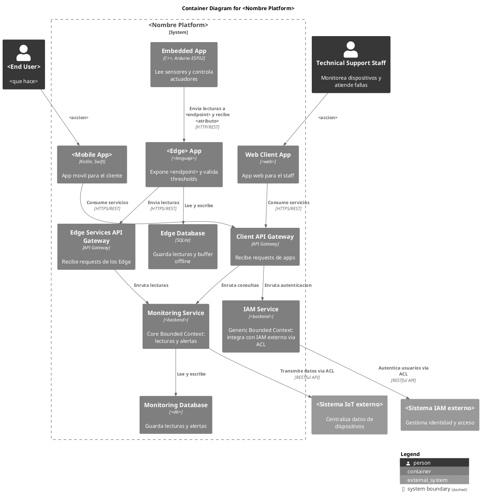

# Guia para resolver los casos 


## Paso 0, Leer el caso y sacar los datos

Antes de responder, lee el caso y llena este cuadro, con esto ya tienes el 80 % del examen

| Dato que buscas | Donde aparece en el caso | Lo usas en |
|---|---|---|
| Nombre de la empresa y solucion | Inicio del caso | Todas |
| Nombre del dispositivo (ej VCCU, APMU) | Parrafo del hardware | P1, P2, P4, P5 |
| Microcontrolador (casi siempre ESP32) | Parrafo del hardware | P1, P2, P5 |
| Sensores (ej DHT22, BH1750) | Parrafo del hardware | P1, P2, P5 |
| Actuadores (LEDs, LCD, servos) | Parrafo del hardware | P1, P2, P5 |
| Nombre y color de cada LED | Parrafo del hardware | P5 |
| Endpoint REST (ej /data-records) | Parrafo del hardware | P4, P5 |
| Atributo del response (ej thresholdLedState) | Parrafo del hardware | P5 |
| Nombre del Edge (Edge Connector, Edge Gateway) | Parrafo del hardware | P2, P4 |
| Lenguaje del backend | Parrafo del Cloud Backend | P4 |
| Base de datos | Parrafo del Cloud Backend | P4 |
| Cuantos API Gateways | Parrafo del Cloud Backend | P4 |
| Tecnologia web y para quien es | Parrafo del Cloud Backend | P3, P4 |
| Sistemas externos (IAM, IoT Connect, otros) | Parrafo del Cloud Backend | P4 |
| Funciones de la app movil | Parrafo de la app | P3, P4 |
| Rangos permitidos (ej 18 a 22 grados C) | Donde hable de condiciones | P2 |
| Lugar donde esta el dispositivo (casa, mar, campo) | Todo el caso | P1 |

---

## Pregunta 1, Power Supply y Time-delay (2 p.)

### Pasos

1, Lista todos los dispositivos del caso, el microcontrolador, cada sensor, cada actuador y el Edge
2, Decide la alimentacion segun el lugar
3, Pon el consumo de cada uno con el cuadro de referencia
4, Agrega un respaldo para lo critico
5, Para time-delay, sigue el flujo del caso paso a paso y ponle un tiempo a cada uno

### Como decidir la alimentacion

| Lugar del dispositivo | Alimentacion | Respaldo |
|---|---|---|
| Casa u oficina (cava, humidor) | Red electrica 220V o 230V a 5V y 3.3V | Bateria 18650 o UPS |
| Tienda o evento | Red 220V | UPS |
| Campo, mar, exterior | Panel solar + bateria 12V | Bateria con autonomia de dias |
| Lectores moviles | Bateria propia | Power bank |

### Consumos de referencia (memorizalos)

| Componente | Voltaje | Consumo |
|---|---|---|
| ESP32 | 3.3V | 240 mA pico WiFi |
| DHT22 | 3.3V a 5V | 1.5 mA |
| DS18B20 | 3.3V a 5V | 1.5 mA |
| BH1750 | 3.3V | 0.12 mA |
| SW-420 | 3.3V a 5V | 5 mA |
| RC522 | 3.3V | 13 a 26 mA |
| EZO (Atlas Scientific) | 3.3V a 5V | 13 a 18 mA |
| LCD con backlight | 5V | 80 a 120 mA |
| LED | 3.3V | 20 mA |
| Servo SG90 | 5V | 650 mA pico |
| Raspberry Pi (Edge) | 5V | 3 a 15 W |

### Tiempos de referencia para time-delay

| Tipo de proceso | Tiempo |
|---|---|
| Accion local (LED, deteccion por interrupcion) | 100 ms |
| Validacion local (RFID, tokens) | 500 ms |
| Lectura de sensor | segun el sensor, DHT22 cada 2 s |
| Actualizar LCD | 1 s |
| Envio periodico al Edge | cada 30 s |
| Request y response con el Edge | 2 s |
| Alerta en la app | 30 s |
| Envio a la nube o sistema externo | cada 1 a 5 min |
| Operacion offline del Edge | hasta 24 horas |

Truco, si algo es critico (oxigeno de peces, puerta abierta) ponle tiempo mas corto y dilo

---

## Pregunta 2, Physical layer (3 p.)

### a) Nodos

1, Cuenta cuantos dispositivos hay por lugar, si el caso no dice cuantos, asume un ejemplo y dilo (ej 1 por cava, 10 por centro)
2, Haz el cuadro, Nodo, Cantidad, Sensores, Actuadores
3, Al final pon el total de sensores y actuadores

Ejemplo de cuadro

| Nodo | Cantidad | Sensores | Actuadores |
|---|---|---|---|
| <Dispositivo> | 1 | <sensores> | <actuadores> |
| <Edge> | 1 | - | - |
| Total | 2 nodos | X sensores | X actuadores |

### b) Target uncertainty, usa el datasheet del sensor

| Sensor | Mide | Incertidumbre |
|---|---|---|
| DHT22 | Temperatura | ±0.5 grados C |
| DHT22 | Humedad | ±2 a 5 % RH |
| DS18B20 | Temperatura | ±0.5 grados C |
| BH1750 | Luz | ±20 %, resolucion 1 lx |
| SW-420 | Vibracion | digital, si o no |
| RC522 | RFID | hasta 5 cm, error menor a 1 % |
| EZO-DO | Oxigeno | ±0.05 mg/L |
| EZO-PH | pH | ±0.02 |

Si el caso da un rango permitido (ej 65 a 72 %) ponlo en el cuadro, el profesor valora que uses los datos del caso

### c) Accuracy and precision de actuadores

| Actuador | Exactitud | Precision |
|---|---|---|
| LED de alerta | 100 % igual al atributo del response | responde en 100 ms |
| LED de power | encendido si hay energia | estable |
| LCD | muestra el valor medido | cantidad de decimales por valor |
| Servo | ±2 grados | ±1 grado |

### d) Processing power

1, Separa lo que hace el dispositivo (leer y enviar) y lo que hace el Edge (validar y procesar)
2, Lista algoritmos simples, validacion de umbrales, media movil, deteccion de cambios bruscos, buffer offline
3, Ponle carga Baja o Media a cada uno
4, Pon el hardware del Edge y un porcentaje de uso total
5, Fog node, di si aplica o no y por que, normalmente no aplica porque cada lugar tiene su propio Edge

| Algoritmo | Donde | Carga |
|---|---|---|
| Lectura de sensores | Dispositivo (ESP32) | Baja |
| Armado del JSON y envio REST | Dispositivo (ESP32) | Baja |
| Validacion de thresholds | Edge | Baja |
| Media movil de 5 lecturas | Edge | Baja |
| Deteccion de cambios bruscos | Edge | Media |
| Buffer offline y reenvio | Edge | Media |
| Total | Edge (Raspberry Pi) | menor a 20 % CPU |

---

## Pregunta 3, Information layer (4 p.)

### Pasos

1, Busca todas las personas del caso, clientes, staff, tecnicos, R&D, reguladores
2, Para cada uno, saca los servicios de lo que el caso dice que hace o de las funciones de la app
3, Para cada servicio, piensa que datos necesita para funcionar

### Donde salen los usuarios

| Si el caso dice | Usuario |
|---|---|
| Aplicacion movil para usuarios finales | El cliente (Wine Lover, Cigar Owner, Participant) |
| Technical support staff | Technical Support Staff |
| CRM staff | CRM Staff |
| Equipo de investigacion y desarrollo | R&D Team |
| Operadores en campo | Field Operator |

### Cuadro para responder

| Usuario final | Servicios | Informacion integrada necesaria |
|---|---|---|
| <Usuario> | <que hace> | <que datos necesita> |

Regla, la informacion integrada siempre mezcla datos de varios lugares, por ejemplo lecturas del sensor + configuracion + historial, eso es lo que significa integrada

---

## Pregunta 4, Container Diagram C4 (5 p.)

### Pasos

1, Personas, los mismos usuarios de la P3
2, Sistemas externos, todos los que el caso dice que son provistos por otro (IAM, IoT Connect, Vivino, ERP)
3, Containers fijos que casi siempre van

| Container | Tecnologia | Tag |
|---|---|---|
| Embedded App | C++, Arduino ESP32 | IoT |
| Edge App | Lenguaje del caso o el mismo del backend | Edge |
| Edge Database | SQLite | Database |
| Mobile App | Kotlin, Swift | MobileApp |
| Web Client App | La que diga el caso | Browser |
| API Gateway(s) | API Gateway | Gateway |
| Microservicios | Lenguaje del caso | Microservice |
| Base de datos por microservicio | La que diga el caso | Database |

4, Saca los bounded contexts de lo que hace el sistema y clasificalos

| Tipo | Regla | Ejemplos |
|---|---|---|
| Core | Lo que hace unica a la empresa | Monitoring, gestion del dispositivo, coleccion de vinos |
| Supporting | Ayuda al negocio pero no lo diferencia | CRM, mantenimiento, dispositivos |
| Generic | Lo tiene cualquier sistema | IAM, contenido, analytics |

5, Relaciones, sigue el flujo, Persona a App, App a Gateway, Gateway a microservicio, microservicio a su base de datos, microservicio a sistema externo via ACL, Embedded a Edge, Edge a Gateway
6, Descripciones y conectores en español, nombres en ingles

### Plantilla (cambia lo que esta entre <>)



Agrega mas microservicios segun el caso, copiando el bloque de Monitoring y su base de datos

---

## Pregunta 5, Class Diagram ModestIoT (6 p.)

### Pasos

1, Copia la parte fija de ModestIoT, nunca cambia
2, Cada sensor del caso es una clase que hereda de Sensor
3, Cada tipo de actuador es una clase que hereda de Actuator, si hay 2 LEDs usa una sola clase Led con 2 instancias
4, El dispositivo principal hereda de Device (ej CellarControlUnit)
5, Crea una clase cliente para el endpoint (ej EdgeConnectorClient), no hereda de nada
6, Agrega atributos y metodos con estas reglas

| Tipo de clase | Atributos | Metodos |
|---|---|---|
| Sensor | libreria del sensor, valor medido | read(), getValor() |
| Actuator | estado o libreria | handle(command), metodo propio |
| Device | id, intervalo, una variable por cada sensor y actuador | setup(), loop(), on(event), handle(command) |
| Cliente Edge | url, endpoint | send...() que devuelve int (el atributo del LED) |

7, Eventos en sensores ({static} ... : Event) y comandos en actuadores ({static} ... : Command)
8, Relaciones, herencia hacia arriba, composicion del Device a sus partes

### Nombres de clase segun componente

| Componente | Clase |
|---|---|
| DHT22 | TemperatureHumiditySensor |
| DS18B20 | TemperatureSensor |
| BH1750 | LightSensor |
| SW-420 | VibrationSensor |
| RC522 | RfidReader |
| EZO-DO | DissolvedOxygenSensor |
| EZO-PH | PhSensor |
| LED | Led |
| LCD | LcdDisplay |
| SG90 | ServoMotor o DispenserServo |

### Plantilla completa (cambia lo que esta entre <>)

Recuerda, en editor.plantuml.com las llaves van en lineas separadas

```plantuml
@startuml <nombre>-class
' Styling approximations for Structurizr look
skinparam monochrome true
skinparam shadowing false
skinparam defaultFontName Arial
skinparam Handwritten false
skinparam Padding 2

top to bottom direction

title Class Diagram for <Dispositivo> (ModestIoT)

class Event {
  +id : int
}

class Command {
  +id : int
}

interface EventHandler {
  +on(event : Event) : void
}

interface CommandHandler {
  +handle(command : Command) : void
}

abstract class Device {
  +on(event : Event) : void
  +handle(command : Command) : void
}

class Sensor {
  #pin : int
  #handler : EventHandler*
  +on(event : Event) : void
  +setHandler(handler : EventHandler*) : void
}

class Actuator {
  #pin : int
  #handler : CommandHandler*
  +handle(command : Command) : void
  +setHandler(handler : CommandHandler*) : void
}

class <SensorClass> {
  +{static} <VALUE_READ> : Event
  -<libreria> : <Tipo>
  -<valor> : float
  +read() : float
  +get<Valor>() : float
}

class Led {
  +{static} TURN_ON : Command
  +{static} TURN_OFF : Command
  -state : bool
  +handle(command : Command) : void
  +getState() : bool
}

class LcdDisplay {
  +{static} SHOW_READINGS : Command
  -lcd : LiquidCrystal_I2C
  +handle(command : Command) : void
  +showReadings(<valores>) : void
}

class <Edge>Client {
  -edgeUrl : String
  -endpoint : String
  +send<Data>(<valores>) : int
}

class <Dispositivo>ControlUnit {
  -deviceId : String
  -sendInterval : unsigned long
  -lastSendTime : unsigned long
  -<sensor> : <SensorClass>
  -lcdDisplay : LcdDisplay
  -powerLed : Led
  -<alertLed> : Led
  -edgeClient : <Edge>Client
  +setup() : void
  +loop() : void
  +on(event : Event) : void
  +handle(command : Command) : void
  -sendReadings() : void
  -update<AlertLed>(<atributo> : int) : void
}

EventHandler <|.down. Sensor
CommandHandler <|.down. Actuator
EventHandler <|.down. Device
CommandHandler <|.down. Device
Sensor <|-down- <SensorClass>
Actuator <|-down- Led
Actuator <|-down- LcdDisplay
Device <|-down- <Dispositivo>ControlUnit
<Dispositivo>ControlUnit *-down- <SensorClass>
<Dispositivo>ControlUnit *-down- "2" Led
<Dispositivo>ControlUnit *-down- LcdDisplay
<Dispositivo>ControlUnit *-down- <Edge>Client
EventHandler ..> Event
CommandHandler ..> Command
@enduml
```

---

## Como sustentar (P4 y P5)

Formula simple, Decision + Por que + Dato del caso
Ejemplo, Uso PostgreSQL por microservicio porque el caso lo indica y DDD pide que cada bounded context tenga su propia base de datos

### Frases listas para P4

| Decision | Sustento |
|---|---|
| Un microservicio por bounded context | Lo pide el caso, aplica DDD |
| Base de datos propia por servicio | Cada bounded context es independiente |
| Dos API Gateways | El caso pide segmentar por tipo de cliente |
| ACL hacia sistemas externos | Son sistemas pre-existentes, el ACL protege el modelo propio |
| Edge con SQLite | Valida cerca del dispositivo y guarda buffer si cae internet |
| REST entre dispositivo y Edge | Lo define el caso con el endpoint |
| Core, Supporting, Generic | Segun que tanto diferencia al negocio |
| InfluxDB para telemetria (si aplica) | La telemetria es serie de tiempo |
| Message Broker (si aplica) | Desacopla servicios con eventos asincronos |

### Frases listas para P5

| Decision | Sustento |
|---|---|
| Jerarquia ModestIoT | Lo pide el caso como technical constraint |
| Sensores heredan de Sensor | Generan eventos |
| Actuadores heredan de Actuator | Reciben comandos |
| Una clase Led | Evita duplicar codigo, solo cambia el pin |
| Clase cliente del Edge | Encapsula el request y devuelve el atributo del LED |
| El dispositivo no valida umbrales | Lo hace el Edge como dice el caso |
| Composicion | Las partes viven y mueren con el dispositivo |
| Una clase por archivo .h y .cpp | Facilita la implementacion al otro equipo |
| Librerias dentro de cada clase | Si cambia el hardware solo cambia esa clase |
| Eventos y comandos static | Evita numeros magicos en el codigo |

Siempre cierra P5 con el flujo principal, al encender se prende el powerLed, cada X s lee sensores, muestra en LCD, envia al Edge, recibe el atributo, si es 1 enciende el LED de alerta, si es 0 lo apaga

---

## Checklist final antes de entregar

| Revisar | Listo |
|---|---|
| Use el nombre exacto del dispositivo, endpoint y atributo del caso | |
| Use el lenguaje y base de datos que dice el caso | |
| Puse todos los sensores y actuadores | |
| Puse todos los sistemas externos | |
| Nombres en ingles, descripciones en español en el C4 | |
| Diagramas en vertical y con llaves en lineas separadas | |
| Cada diagrama tiene su sustento | |
| Probe el codigo en editor.plantuml.com | |
